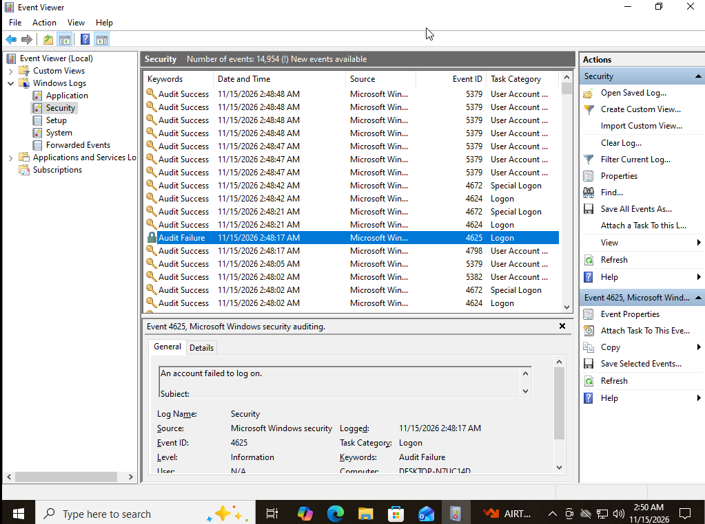
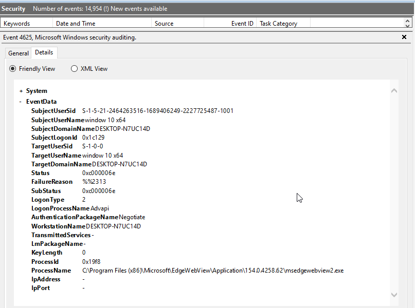
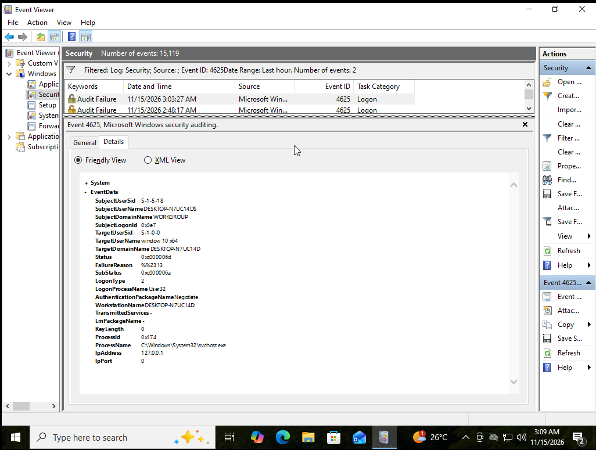
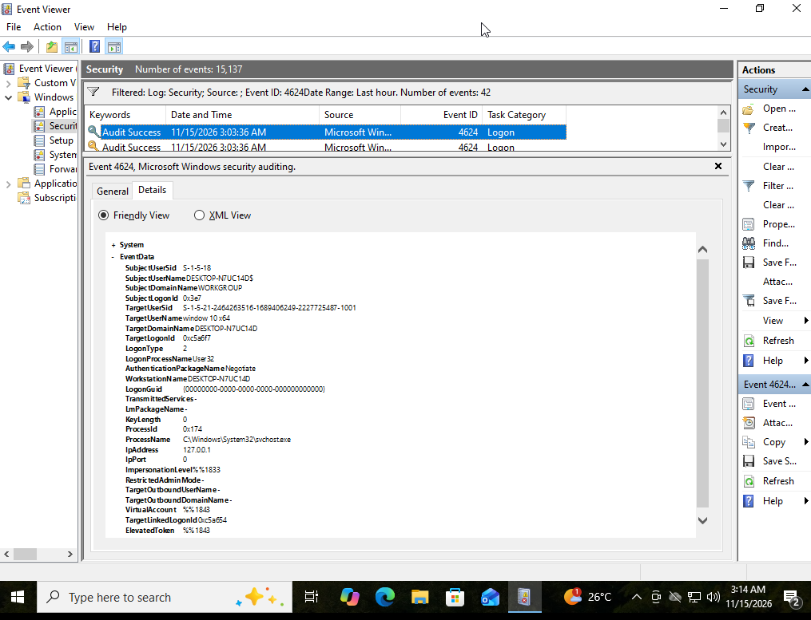
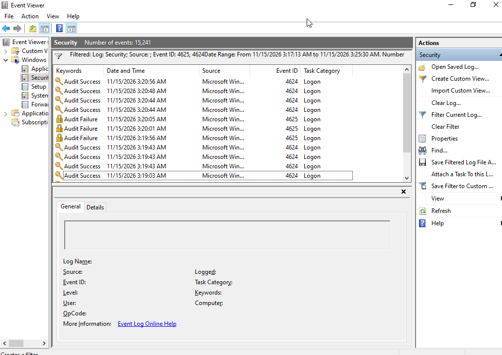

# Windows Event Logs Investigation 

## About This Project

I created this project to practice **Windows Event Log Analysis** and understand how a SOC Analyst can investigate login activity on a Windows system.

I used my **Windows 10 virtual machine in VMware Workstation** and **Windows Event Viewer** for this lab.

Instead of only learning Event IDs theoretically, I generated login activity myself and then checked the Security logs to understand what Windows recorded.

In this project, I mainly investigated:

- Event ID **4624** \- Successful Logon
- Event ID **4625** \- Failed Logon
- Single failed login attempts
- Multiple failed login attempts
- Successful login after failed attempts
- Basic event correlation

---

## My Lab Setup

For this project I used:

- Windows 10 Virtual Machine
- VMware Workstation
- Windows Event Viewer
- Windows Security Logs

All the login activity in this project was created by me inside my own lab environment for learning and testing.

---

## What I Did

First, I opened Event Viewer and navigated to:

**Windows Logs → Security**

There were many security events, so I started filtering the logs using specific Event IDs.

The first important event I investigated was **Event ID 4625**.

---

## Investigation 1 \- Failed Login

I intentionally entered an incorrect password on my Windows VM.

After that, I opened the Security logs and filtered for:

**Event ID: 4625**

Windows recorded the failed login attempt.

Some of the important information I checked inside the event was:

- Target User Name
- Target Domain
- Status
- SubStatus
- Logon Type
- Logon Process
- Authentication Package
- Workstation Name
- Process Name
- IP Address

### Event 4625 Details

The following screenshot shows the detailed EventData fields I examined:

During my controlled failed\-login test, I observed:

- **Event ID:** 4625
- **Logon Type:** 2
- **Logon Process:** User32
- **Authentication Package:** Negotiate
- **IP Address:** 127.0.0.1

### Controlled Failed Login Evidence

This helped me understand that simply finding Event ID 4625 is not enough. I also need to examine the information inside the event to understand what actually happened.

---

## Investigation 2 \- Successful Login

After generating the failed login, I logged into the Windows VM successfully.

Then I filtered the Security logs for:

**Event ID: 4624**

This showed successful login activity.

Some of the important values I observed were:

- **Event ID:** 4624
- **Logon Type:** 2
- **Logon Process:** User32
- **Authentication Package:** Negotiate
- **IP Address:** 127.0.0.1

### Successful Login Evidence

I learned how Event ID 4624 and Event ID 4625 represent different authentication results:

**4625 → Failed Login**

**4624 → Successful Login**

This also helped me understand how related authentication events can be compared during an investigation.

---

## Investigation 3 \- Multiple Failed Login Attempts

Next, I wanted to see what repeated failed logins look like in Windows Event Viewer.

Inside my own Windows VM, I intentionally entered an incorrect password three times.

After checking Event Viewer, I found three Event ID 4625 entries close together:

- **03:19:56 AM \- 4625**
- **03:20:01 AM \- 4625**
- **03:20:05 AM \- 4625**

After that, successful 4624 login activity appeared.

The authentication pattern looked like:

**4625 → 4625 → 4625 → 4624**

### Repeated Failed Login Evidence

This was one of the most useful parts of the project because I started understanding that a SOC Analyst should not always investigate only one event.

Multiple related events can be compared using their timestamps and other information to understand what happened over a period of time.

In this lab, I already knew why the failed logins occurred because I generated them myself. In a real investigation, I would need to examine the surrounding context before deciding whether the activity was suspicious.

---

## What I Learned

Before doing this project, I knew that Event Viewer contained Windows logs, but I had not properly investigated authentication events like this.

After completing this lab, I learned:

- How to navigate Windows Event Viewer
- How to check Windows Security logs
- How to filter logs using Event IDs
- What Event ID 4624 represents
- What Event ID 4625 represents
- How to investigate failed login information
- How to investigate successful login information
- How to identify Logon Type
- How to check account, process, and network information
- How to compare multiple security events
- How timestamps can help build an event timeline
- How to perform basic event correlation
- Why one failed login does not automatically mean an attack

### My Biggest Learning

**Don't only look at the Event ID. Check the complete event and understand the context.**

---

## Evidence Collected

All investigation screenshots are stored in the **Screenshots** folder of this repository.

The evidence includes:

1. Windows Security Event Log
2. Event ID 4625 detailed information
3. Controlled failed login event
4. Event ID 4624 successful login
5. Multiple Event ID 4625 failures and subsequent successful activity

---

## Skills Practiced

Through this project I practiced:

- Windows Event Viewer
- Windows Security Logs
- Log Analysis
- Event ID Analysis
- Failed Login Investigation
- Successful Login Investigation
- Authentication Analysis
- Event Filtering
- Timeline Analysis
- Basic Event Correlation
- SOC Investigation Fundamentals
- Security Investigation Documentation

---

## SOC Analyst Thinking

One important thing I understood from this project is that seeing a failed login does not automatically mean somebody is attacking the system.

As an analyst, I should first investigate questions such as:

- Which account was involved?
- When did the login happen?
- Was the login successful or unsuccessful?
- What was the Logon Type?
- Where did the activity come from?
- Were there multiple failed attempts?
- Was there a successful login afterward?
- Is this activity expected or unusual?

In my lab, I already knew the activity was expected because I generated it myself.

In a real investigation, I would need more evidence and context before reaching a conclusion.

---

## Project Conclusion

This was my first practical **Windows Event Log Investigation** project.

The project helped me move from simply knowing terms like **log analysis** to actually opening Windows Security logs, generating authentication activity, investigating events, comparing related events, building a basic timeline, and documenting my findings.

I am currently building my practical skills for entry\-level **SOC Analyst and Cybersecurity roles**, and I plan to continue improving this project as I learn more about Windows logging and SIEM technologies.

---

## Next Steps 🚀

I plan to continue learning and practicing:

- More Windows Security Event IDs
- Windows logoff events
- Windows account activity
- PowerShell logging
- Sysmon
- Windows Defender logs
- SIEM log monitoring
- Alert investigation
- Basic detection rules
- MITRE ATT&CK

---

## Author

**Nikhil Rana**

Cybersecurity Intern \| SOC & Network Security \| Linux

Currently learning and building practical cybersecurity projects for SOC Analyst and entry\-level cybersecurity roles.

